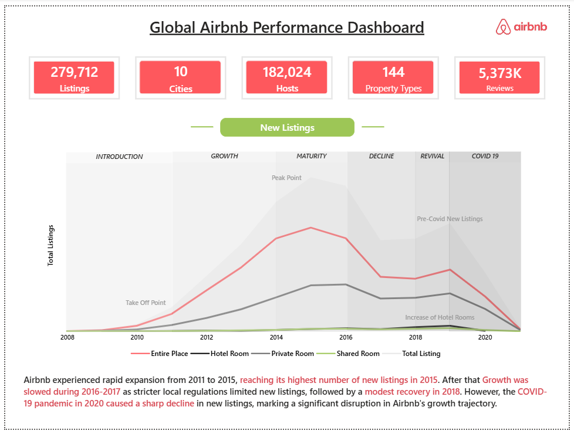
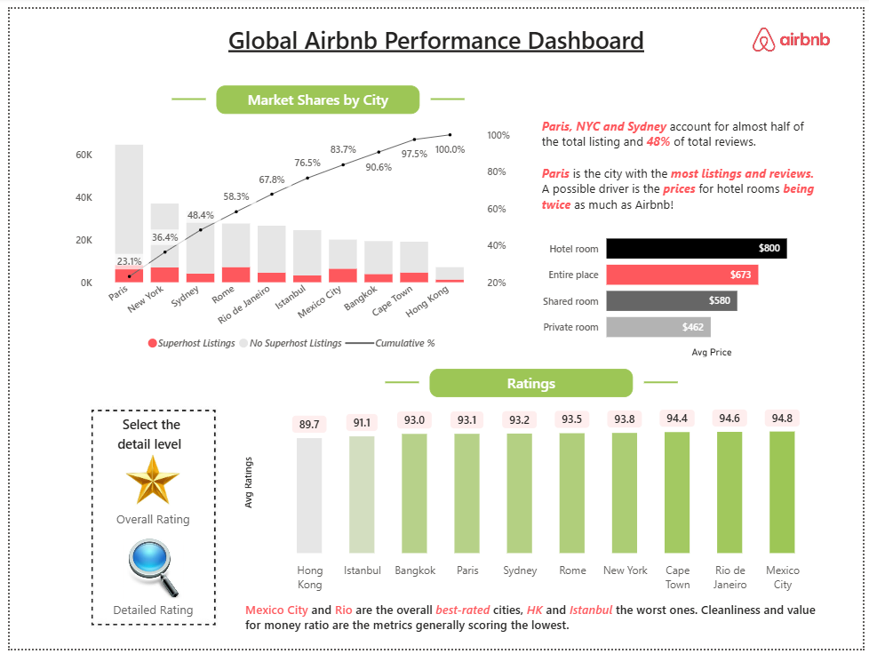
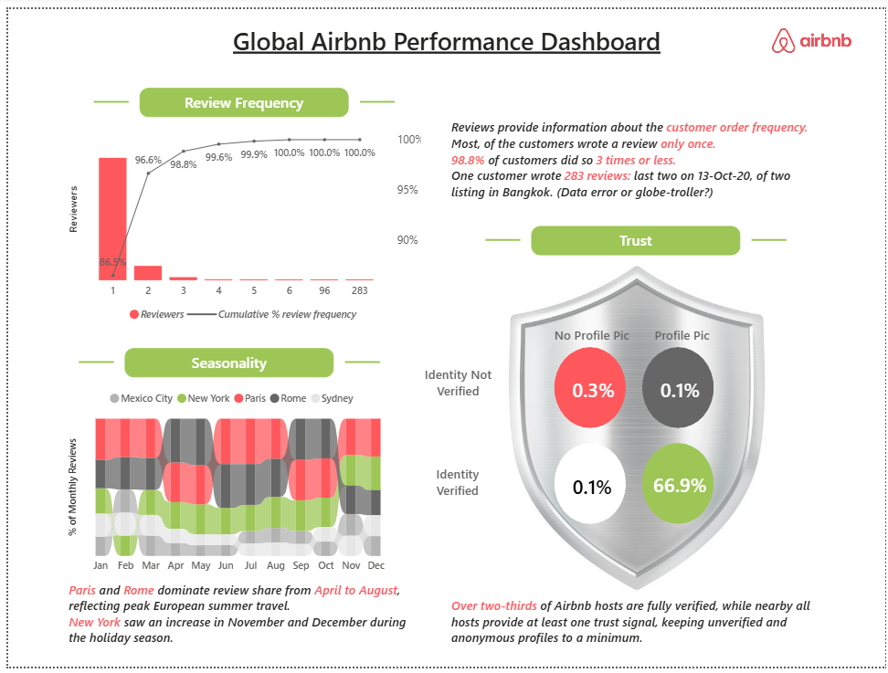

# 🏠 Global Airbnb Performance Dashboard — Power BI

A 3-page interactive Power BI dashboard analysing Airbnb's global growth, city-level ratings, and review/trust patterns — presented as a narrative timeline rather than a raw data dump.

---

## 📊 Dashboard Preview

> Full interactive `.pbix` file is too large for GitHub — see download link below. Screenshots of all 3 pages included in this repo.

---

## 📥 Download the Full Interactive Dashboard

The `.pbix` file (~205MB) exceeds GitHub's file size limits and is hosted externally instead:

**🔗 [Download from Google Drive](https://drive.google.com/file/d/1TwZKCvxnDcbBgOOwmEapPM-xCHOFwgQm/view?usp=drive_link)**

Open the downloaded file in **Power BI Desktop** (free from Microsoft) to interact with filters, slicers, and drill-throughs across all 3 pages.

---

## 🎯 Project Objective

To tell the story of Airbnb's platform evolution and market performance through three connected lenses:
1. **Overview** — How has Airbnb's growth evolved over time, through distinct lifecycle stages?
2. **Ratings** — Which cities perform best, and what drives rating differences across markets?
3. **Reviews** — What do review patterns reveal about customer trust and seasonal travel behavior?

---

## 🗄️ Dataset

**Source:** [Maven Analytics — Data Playground](https://mavenanalytics.io/data-playground) — Airbnb Listing & Reviews Dataset

| Detail | Info |
|---|---|
| Provider | Maven Analytics |
| Domain | Global short-term rental / hospitality |
| Scope | Multi-city Airbnb listings, ratings, and reviews data |
| Tool used | Power BI Desktop |

---

## 📁 Report Structure

| Page | Focus | Visual count |
|---|---|---|
| **Overview** | Growth timeline (2011–2020+) segmented into lifecycle stages: Introduction, Growth, Maturity, Decline, Revival, COVID-19 | 26 visuals |
| **Ratings** | City-level market share, overall vs. detailed rating breakdowns, best/worst-rated cities | 25 visuals |
| **Reviews** | Review frequency, host trust signals (verification & profile completeness), seasonal review patterns by city | 36 visuals |

---

## 🔑 Key Findings

1. **Airbnb's growth followed a clear lifecycle** — rapid expansion from 2011 to 2015 (peak new-listing year), followed by a growth slowdown starting in 2016, well before the COVID-19 disruption.
2. **Three cities dominate the platform** — Paris, New York City, and Sydney together account for almost half of all listings and 48% of total reviews, with Paris leading in both listings and reviews.
3. **Rating quality varies significantly by city** — Mexico City and Rio de Janeiro are the highest-rated markets overall, while Hong Kong and Istanbul rank lowest, with cleanliness and value-for-money identified as key differentiating metrics.
4. **Guests rarely leave repeat reviews** — 98.8% of customers who left a review did so only once (or up to 3 times), indicating most hosts see one-time rather than repeat engagement per guest.
5. **Trust signals are strong across the platform** — over two-thirds of hosts are fully identity-verified, and nearly all hosts provide at least one trust signal, with very few unverified or anonymous profiles.
6. **Review activity follows clear seasonal travel patterns** — Paris and Rome dominate review volume from April to August (peak European summer travel), while New York sees a distinct pickup in November and December.

---

## 🛠️ Power BI Skills Demonstrated

| Skill | Where it's used |
|---|---|
| Narrative dashboard design | Lifecycle timeline with custom shape annotations (Overview page) |
| Card visuals & KPIs | Growth metrics, trust signal counts, review frequency stats |
| Combo charts | Line + stacked column combinations for growth and seasonality trends |
| Ribbon charts | Rank-change visualization on the Reviews page — an advanced, less common visual type |
| Pivot tables | Detailed rating and review breakdowns by city |
| Custom visuals & images | Registered image resources used as icons/illustrations across all 3 pages |
| Interactive detail selectors | "Select the detail level" control on the Ratings page |
| Data storytelling | Written insight callouts embedded directly in the report (not left for the viewer to infer) |

---

## 🚀 How to Open This Project

1. Click the **Google Drive link above** to download `airbnb_performance_dashboard.pbix`
2. Open the file in **Power BI Desktop** (free — download from Microsoft if needed)
3. Navigate between the 3 report pages using the tabs at the bottom
4. Use the detail-level selector on the Ratings page to switch between summary and granular views

---

## 💡 What I Learned

- How to structure a multi-page Power BI report as a narrative rather than a collection of disconnected charts — starting with a lifecycle overview, then drilling into ratings, then into reviews.
- Using combo charts and ribbon charts to show trends and rank changes over time, rather than defaulting only to standard bar/column charts.
- The value of writing insight callouts directly into the report using textboxes — turning passive charts into an active, guided analysis a viewer can follow without needing verbal explanation.
- How to analyze indirect signals of trust and engagement (profile completeness, verification status, review frequency) as a proxy for platform health, beyond just revenue or booking metrics.

---

## 🙋 About

Built by **[Atharv Dhole]** as part of a data analyst portfolio project.

- 🔗 LinkedIn: [https://www.linkedin.com/in/atharv-dhole/]
- 📧 Email: atharvdhole22@email.com

---

*If you found this useful, please ⭐ star the repository!*
